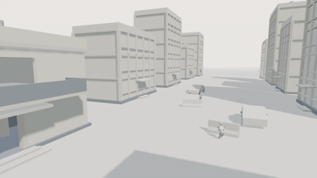

# AI 3D Previs Studio (白模预演片场)

> **持久化 3D 白模世界 × 大模型语义化导演 × 专业运镜控制 × 多通道 AI 视频控制信号导出**
>
> 专为解决 AI 生视频（Sora / Kling / Runway / CogVideoX / Wan 2.1 / SVD）的**「空间抽卡、结构融化、运镜不准、一景无法多拍」**等核心痛点而设计的 Web 3D 预演与空间约束工作台。

<p align="center">
  
</p>

<p align="center">
  <a href="http://144.48.241.164" target="_blank"><strong>🌐 在线体验 Demo 试玩 (Live Demo: 144.48.241.164)</strong></a>
  <br />
  <sub>🔑 访问账号：<code>demo</code> &nbsp;|&nbsp; 访问密码：<code>h123zb</code></sub>
</p>

<p align="center">
  <a href="https://react.dev/"></a>
  <a href="https://threejs.org/"></a>
  <a href="https://vitejs.dev/"></a>
  <a href="https://www.typescriptlang.org/"></a>
  <a href="https://tailwindcss.com/"></a>
  <a href="LICENSE"></a>
</p>

---

## 📖 核心痛点与解决理念

当前 AI 视频生成技术在影视、广告和分镜创作中面临两大严重瓶颈：
1. **空间结构无约束**：纯文本或单图扩散模型缺乏底层三维空间几何约束，运镜一动极易发生透视崩坏、人体结构畸变与建筑变形。
2. **场景无法持久沉淀**：每次生成新分镜都要重新让 AI 盲抽，无法在**同一个确定的三维空间**中以多机位进行连贯的机位运镜拍摄。

**AI 3D Previs Studio** 倡导的创作流：
> **「世界只需建造一次，即可无限机位拍摄」**
>
> 先在 3D 空间中精确搭建白模、编辑地形与编排运镜轨迹，直接导出 **Clay白模视频**、**Linear Depth 深度序列**、**Surface Normal 法线图** 与 **相机轨迹参数**，作为 ControlNet / Video Diffusion 模型的强几何先验条件，实现 100% 稳定的高质量电影级 AI 视频输出。
Preview unavailable
---

## ✨ 核心特性

- 🏰 **持久化语义 3D 白模世界 (Semantic Scene Graph)**
  - 基于米制右手系空间坐标体系，场景要素全部以轻量化结构存储。
  - 内置丰富的白模资产库：建筑、道路、地形笔刷、道具、载具、木偶人物（Mannequins）及各类生物预设。
  - 支持程序化现代城市生成、道路网绘制、动态日夜光影变化与大气雾效。

- 🤖 **大模型语义化建造与导演 (LLM DSL Compiler)**
  - 接入 DeepSeek / OpenAI / Ollama 等主流大语言模型。
  - 自然语言意图解析：直接下达 *“在左侧搭建两排赛博风格公寓，中间留出一条 8 米宽的道路，路边停两辆跑车”*，AI 自动输出规范 DSL 并通过增量补丁（JSON Patch）实时装配世界。
  - 内置场景状态压缩器、空间碰撞检测与防穿模校验。

- 🎥 **专业运镜与时间轴系统 (Cinematic Spline Timeline)**
  - 基于 **Catmull-Rom 样条曲线** 的平滑相机轨道设计。
  - 支持关键帧位置、FOV（视场角）、LookAt 聚焦注视点动态插值。
  - 拥有多机位镜头列表（Shot List）与物体级进出场、位移、旋转动画时间轴。

- 🎨 **多通道渲染与确定性视频导出 (Multi-Pass Render & WebCodecs)**
  - **五大渲染通道**：
    1. **Color (自然色彩)**
    2. **Clay (纯白模材质)**
    3. **Linear Depth (精准线性深度)**
    4. **Surface Normal (表面法线)**
    5. **Wireframe (线稿轮廓)**
  - 基于 WebCodecs 与 `webm-muxer` 的离屏确定性渲染器，按固定帧率（24 / 30 / 60 FPS）逐帧渲染并合成无损视频容器，帧级对齐 AI 视频生图管线。
  - 一键导出机位轨迹 JSON 与分镜参数。

- 👥 **原生轻量实时协作 (Zero-Dependency Realtime Collab)**
  - 后端提供极简、零三方依赖的 WebSocket 房间服务 (`collab-server.mjs`)。
  - 毫秒级多端光标协同、视口跟随、场景增量同步与协同聊天。

- 🖥️ **双视口联动交互 (Dual Viewport Layout)**
  - 上帝全局视角（自由俯瞰编辑、变换手柄拖拽）与机位视口（导演最终取景框）同屏实时联动。

---

## 🛠️ 技术栈

| 层次 | 技术选型 | 说明 |
| :--- | :--- | :--- |
| **前端框架** | React 18 + TypeScript + Vite | 现代化极速响应开发栈 |
| **3D 引擎** | Three.js + React Three Fiber + Drei | 工业级 WebGL 场景渲染与材质管线 |
| **状态管理** | Zustand + Immer | 高性能 3D 交互状态流，支持撤销/重做 |
| **视频编码** | WebCodecs API + `webm-muxer` | 浏览器原生逐帧硬编码导出 |
| **样式系统** | Tailwind CSS v4 + Lucide React | 现代暗黑极简片场 UI 设计 |
| **持久存储** | `idb-keyval` (IndexedDB) | 本地多工程快速离线保存 |
| **协作服务端** | Node.js 原生 WebSocket (`node:http` + `node:crypto`) | 零第三方依赖，开箱即用的高性能协作服务 |

---

## 🚀 快速上手

### 1. 环境要求
- [Node.js](https://nodejs.org/) >= 18.0.0
- 推荐使用 npm、pnpm 或 yarn

### 2. 安装依赖
```bash
# 克隆仓库
git clone https://github.com/<your-username>/ai-3d-previs-studio.git
cd ai-3d-previs-studio

# 安装依赖
npm install
```

### 3. 本地开发运行
```bash
# 启动前端开发工作台 (默认端口: http://localhost:5173)
npm run dev
```

### 4. 启动实时协同服务端 (可选)
如果需要多人实时协同编辑与视口同步：
```bash
# 启动 WebSocket 协作后端 (默认端口: 3001)
npm run collab-server
```

### 5. 生产构建打包
```bash
# 构建生产环境静态资源 (输出至 dist 目录)
npm run build

# 本地预览生产构建产物
npm run preview
```

---

## 📁 目录结构

```text
├── docs/                      # 系统设计与 DSL 架构规范文档
│   └── architecture-and-dsl.md
├── public/                    # 静态公共资源
├── server/                    # 实时协同服务端
│   └── collab-server.mjs      # 零依赖 Node 原生 WebSocket 协同服务
├── src/                       # 前端核心源码
│   ├── ai/                    # AI 语义编译器、DSL Schema、空间校验器、LLM 客户端
│   ├── collab/                # 协同客户端管理器与场景 Diff 算法
│   ├── components/            # UI 组件层
│   │   ├── ui/                # 时间轴、属性检查器、镜头列表、API配置等面板
│   │   └── viewport/          # 3D 视口、双视口、白模网格、材质与相机控制器
│   ├── data/                  # 白模资产库预设、各时期风格模型、默认世界数据
│   ├── engine/                # 核心引擎：多通道材质池、地形笔刷、视频导出编码器
│   ├── i18n/                  # 国际化语言包 (中/英)
│   ├── store/                 # Zustand 全局状态仓库 (世界图、时间轴、选择态)
│   ├── types/                 # 全局 TypeScript 数据结构与 DSL 类型定义
│   ├── App.tsx                # 应用主入口
│   └── main.tsx
├── index.html                 # 根 HTML 模板
├── package.json               # 项目依赖与运行脚本
├── tsconfig.json              # TypeScript 配置
└── vite.config.ts             # Vite 构建与反向代理配置
```

---

## 📄 开源许可证

本项目采用 [MIT License](LICENSE) 许可证。
